<!--
  FARM-THEMED PROFILE README
  ---------------------------------------------------------------------------
  Still to fill in (search this file for "TODO"; each spot shows a friendly "coming soon" note until then):
    - 01  NAME / EDUCATION / LOCATION rows in the dossier
    - 02  experience, leadership and education cards
    - 05  achievements        06  certifications
    - 08  LinkedIn / portfolio / email links
  Banners, tags, project cards, farm animals and the tech carousel are generated:
    python3 scripts/build_assets.py        (edit the CONFIG block at the top first)
  The crop-yield graph (assets/yield.svg) and the repo table below refresh by themselves:
    .github/workflows/farm-yield.yml  ->  scripts/update_yield.py
-->



 

<!--
  TODO: add these rows to the table below (above SPECIALIZATION) once you have the details:
  | `NAME` | Your full name |
  | `EDUCATION` | University · degree · years |
  | `LOCATION` | City, country |
-->

| | |
|:--|:--|
| `FARMER ID` | **monishrajax** &nbsp;·&nbsp; [github.com/monishrajax](https://github.com/monishrajax) |
| `SPECIALIZATION` | Full-Stack Development & Applied AI |
| `STATUS` | **PLANTING // GROWING // HARVESTING** |

- Full-stack developer who ships products end to end: React and Next.js front ends, Express and Flask back ends, Postgres and Supabase underneath.
- Shipped and online: **NORMALIZE** (a single-product storefront built with Razorpay checkout), **VisaGuard** (an agentic-AI compliance platform demo) and **Don't Touch the Floor** (a multiplayer arcade game).
- Hands-on with applied AI: TF-IDF and cosine-similarity retrieval, in-browser OCR pipelines and agentic-AI product interfaces.
- Comfortable with the delivery side too: Docker, Kubernetes and GitHub Actions CI/CD.
- Philosophy: plant early, water daily (commit), harvest often (ship).

 


> 🌱 *Fresh soil: roles, leadership and education are being planted here. Check back soon.*

<!--
  TODO: replace the note above with your real cards. Use one tag image per group:
       then your roles, newest first
           clubs, communities, events, teams
             school or university, degree, years

  EXAMPLE CARD - copy, paste and edit for each role:

  <table>
  <tr><td>

  

  **Role title** · Company

  - What you built or shipped, and the result.
  - Another concrete achievement.

  </td></tr>
  </table>
-->

 


 

<a href="https://www.normalize.world">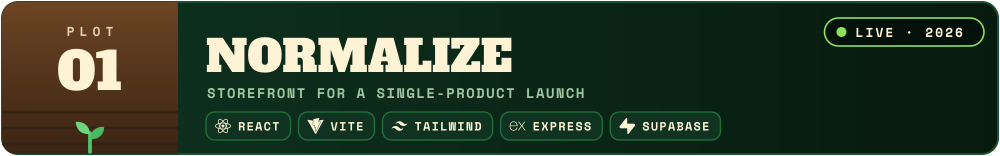</a>

- Single-product launch storefront: React 18 + Vite + Tailwind CSS v4 client, Express API, Supabase Postgres.
- Server-side pricing: the browser never sends a price. The API looks it up in Postgres and opens the Razorpay order, verifies the HMAC-SHA256 payment signature, and a webhook settles orders even if the customer's browser dies mid-checkout.
- Shiprocket logistics, plus a "launch mode" that opens the full catalogue with one database update and no redeploy.
- 33 automated checks run against a throwaway Postgres and the real server: catalogue, pricing, the payment-signature gate and the webhook.

**[▸ Live site](https://www.normalize.world)** &nbsp;·&nbsp; **[▸ Source](https://github.com/monishrajax/normalize-website)**

 

<a href="https://dont-touch-the-ground.vercel.app">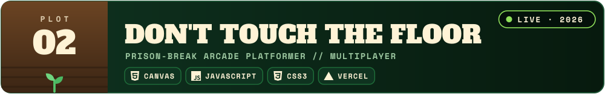</a>

- Prison-break arcade platformer: hop between steel beams, dodge sawblades, shock orbs and barbed wire while a laser alarm floor keeps rising.
- Plain HTML5 Canvas, CSS and JavaScript: no dependencies and no build step. Touch controls for phones.
- Multiplayer: friends race up the same tower by sharing a 5-character game code, with a live scoreboard.

**[▸ Play it](https://dont-touch-the-ground.vercel.app)** &nbsp;·&nbsp; **[▸ Source](https://github.com/monishrajax/Dont-touch-the-ground)**

 

<a href="https://visa-smoky-rho.vercel.app">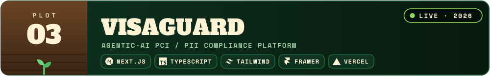</a>

- Marketing and demo site for an agentic-AI-enabled, continuous PCI / PII compliance platform.
- Next.js (App Router) + TypeScript + Tailwind CSS, with Framer Motion micro-interactions and Recharts dashboards.
- Built-in light / dark / system theme toggle.

**[▸ Live demo](https://visa-smoky-rho.vercel.app)** &nbsp;·&nbsp; **[▸ Source](https://github.com/monishrajax/visa)**

 

<a href="https://github.com/monishrajax/Smart-Resume-Job-Matching-Information-Retrieval-System">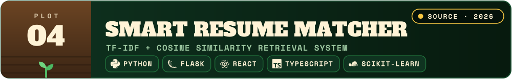</a>

- Full-stack information-retrieval app that ranks uploaded resumes by relevance to a job description.
- Flask REST API: NLTK preprocessing (tokenisation, stop-word removal, lemmatisation), TF-IDF vectors and cosine-similarity ranking with scikit-learn.
- React + TypeScript + Tailwind UI that lists ranked results with similarity percentages.

**[▸ Source](https://github.com/monishrajax/Smart-Resume-Job-Matching-Information-Retrieval-System)**

 

<a href="https://github.com/monishrajax/ID-scanner">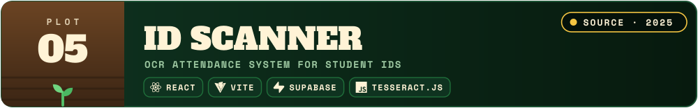</a>

- Attendance system: capture or upload a student ID, run OCR in the browser with Tesseract.js, auto-detect the roll number and mark attendance.
- Supabase stores members, events and attendance, with a unique (roll number, event) constraint to block duplicate check-ins.
- React 18 + Vite with real-time toast feedback.

**[▸ Source](https://github.com/monishrajax/ID-scanner)**

 

<a href="https://github.com/monishrajax/microservices-ci-cd"></a>

- Automates the whole delivery lifecycle: a push to GitHub triggers GitHub Actions, which builds the app, containerises it with Docker and deploys it to a Kubernetes cluster.

**[▸ Source](https://github.com/monishrajax/microservices-ci-cd)**

 

<!-- REPOS:START -->
| Repo | What's growing | Stack | Live | Updated |
|:--|:--|:--|:--:|:--:|
| [**normalize-website**](https://github.com/monishrajax/normalize-website) | Storefront for a single-product launch with Razorpay checkout | React · Express · Supabase | [open](https://www.normalize.world) | 2026‑11‑20 |
| [**Dont-touch-the-ground**](https://github.com/monishrajax/Dont-touch-the-ground) | Prison-break arcade platformer with multiplayer races | JavaScript · Canvas | [open](https://dont-touch-the-ground.vercel.app) | 2026‑10‑17 |
| [**Smart-Resume-Job-Matching-Information-Retrieval-System**](https://github.com/monishrajax/Smart-Resume-Job-Matching-Information-Retrieval-System) | Ranks resumes against a job description (TF-IDF + cosine) | Flask · React · scikit-learn | — | 2026‑04‑06 |
| [**microservices-ci-cd**](https://github.com/monishrajax/microservices-ci-cd) | Commit → build → Docker → Kubernetes delivery pipeline | GitHub Actions · Docker · K8s | — | 2026‑04‑06 |
| [**CIGA-Business-Analytics-Framework**](https://github.com/monishrajax/CIGA-Business-Analytics-Framework) | Real-time intent analytics system that turns user behavior into actionable business insights *(fork)* | Python | — | 2026‑04‑01 |
| [**visa**](https://github.com/monishrajax/visa) | VisaGuard: agentic-AI PCI / PII compliance platform demo | Next.js · TypeScript | [open](https://visa-smoky-rho.vercel.app) | 2026‑01‑05 |
| [**ID-scanner**](https://github.com/monishrajax/ID-scanner) | OCR attendance scanner for student IDs | React · Tesseract.js · Supabase | — | 2025‑12‑20 |
| [**certifi-gen**](https://github.com/monishrajax/certifi-gen) | — | — | — | 2025‑12‑20 |
<!-- REPOS:END -->

 



| | |
|:--|:--|
| `LANGUAGES` | JavaScript · TypeScript · Python · HTML · CSS |
| `FRONT END` | React · Next.js · Vite · Tailwind CSS · Framer Motion · Recharts |
| `BACK END` | Node.js · Express · Flask · REST APIs |
| `DATA & AI` | Supabase · PostgreSQL · scikit-learn · NLTK · Tesseract.js |
| `INTEGRATIONS` | Razorpay · Shiprocket |
| `CLOUD & DEVOPS` | Docker · Kubernetes · GitHub Actions · Vercel · Git |

 


<!-- TODO: add hackathons, awards, rankings or published work: one bullet each, newest first. Then delete the note below. -->
> 🏆 *The trophy shelf is being polished. Achievements land here soon.*

 

<!--
  TODO: add your certifications as a table and delete the note below, for example:
  | | |
  |:--|:--|
  | `Google` | Introduction to Generative AI |
-->
> 🌾 *Certificates are still drying in the barn. Check back soon.*

 



Last 12 months · every active day grows grass · refreshed automatically by a GitHub Action · live graph: [github.com/monishrajax](https://github.com/monishrajax)

 


<!--
  TODO: uncomment these and add your own links
  
  
  
-->

 


Hand-built SVG art, generated by <code>scripts/</code> · type set in Alfa Slab One &amp; Space Mono (SIL OFL 1.1) · logos from Simple Icons (CC0)

